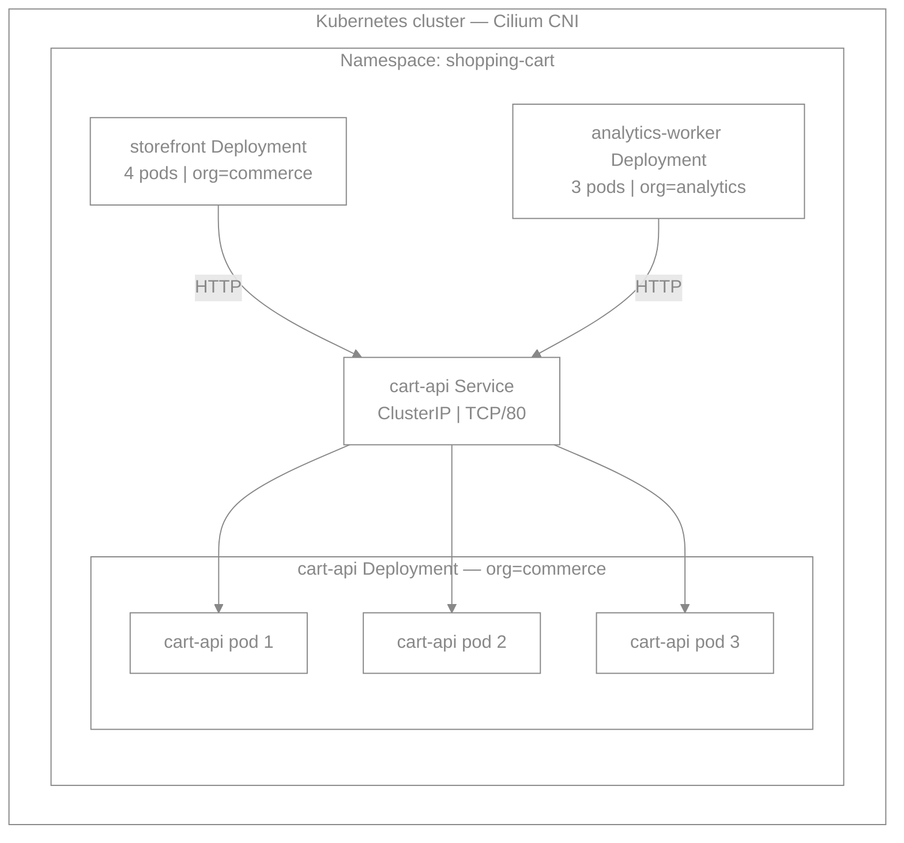

# Lab 01 — Unrestricted Network Connectivity

Establish the Shopping Cart 101 baseline on a
Cilium-managed Kubernetes cluster before introducing
network policies.

## Architecture



## Deploy

Run from the repository root:

```bash
kubectl apply -f lab01/01-namespace.yaml
kubectl apply -f lab01/02-cart-api.yaml
kubectl apply -f lab01/03-clients.yaml
kubectl get pods,svc -n shopping-cart
```

## Test connectivity

```bash
kubectl exec -n shopping-cart deploy/storefront -- \
  curl -i http://cart-api/v1/cart

kubectl exec -n shopping-cart deploy/analytics-worker -- \
  curl -i http://cart-api/v1/cart
```

Both clients can also invoke:

- POST /v1/cart/items
- PUT /v1/cart/discount

## Expected outcome

- Ten running pods across three Deployments.
- Both clients can reach the cart API.
- All supported HTTP operations return HTTP 200.
- East-West communication within the cluster.
- Unrestricted connectivity, assuming default Cilium
  enforcement and no other applicable policies.

The cart API is a stateless mock.

Keep all resources running for Lab 02:
L3 identity-based network policy.