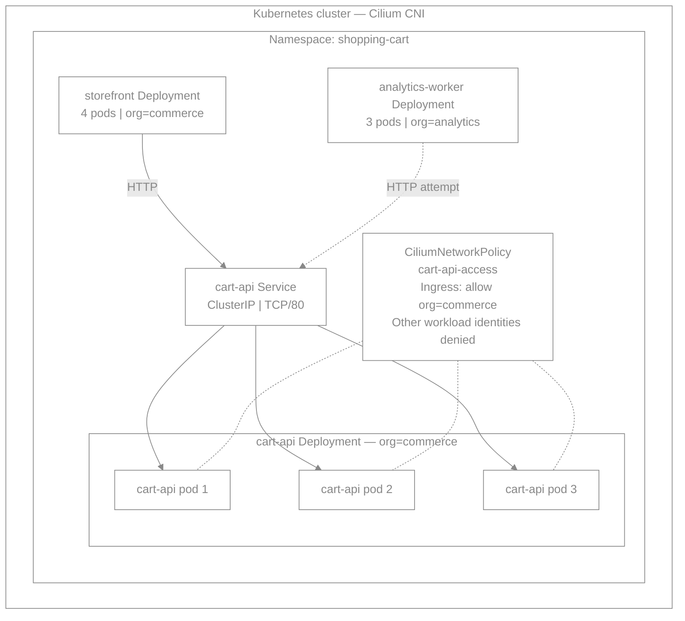

# Lab 02 — L3 Identity-Based Network Policy

Introduce identity-based ingress microsegmentation
to the Shopping Cart 101 environment.

Only workloads labeled `org=commerce` in the
`shopping-cart` namespace may access the cart API.

## Architecture



Cilium enforces the ingress policy at the cart-api
endpoints, not at the ClusterIP Service.

## Deploy

Assumes Lab 01 is running.

```bash
kubectl apply -f lab02/01-l3-network-policy.yaml
kubectl get cnp -n shopping-cart
```

## Test connectivity

### Authorized workload — storefront

```bash
kubectl exec -n shopping-cart deploy/storefront -- \
  curl --max-time 5 -i http://cart-api/v1/cart

kubectl exec -n shopping-cart deploy/storefront -- \
  curl --max-time 5 -i -X POST http://cart-api/v1/cart/items

kubectl exec -n shopping-cart deploy/storefront -- \
  curl --max-time 5 -i -X PUT http://cart-api/v1/cart/discount
```

Expected: HTTP 200 for all three operations.

### Unauthorized workload — analytics-worker

```bash
kubectl exec -n shopping-cart deploy/analytics-worker -- \
  curl --max-time 5 -i http://cart-api/v1/cart
```

Expected: connection failure, typically a timeout.

## Inspect Cilium identities

```bash
kubectl get ciliumendpoints -n shopping-cart
```

## Expected outcome

- Cart API ingress enters default-deny mode.
- Storefront traffic is allowed.
- Analytics-worker traffic is dropped.
- No port or HTTP operation restrictions.
- No application code or Service changes.
- Identity-based rather than IP-based segmentation.

Results assume default Cilium policy enforcement
and no other applicable policies changing connectivity.

Keep the policy in place for Lab 03:
L4 port and protocol-based network policy.